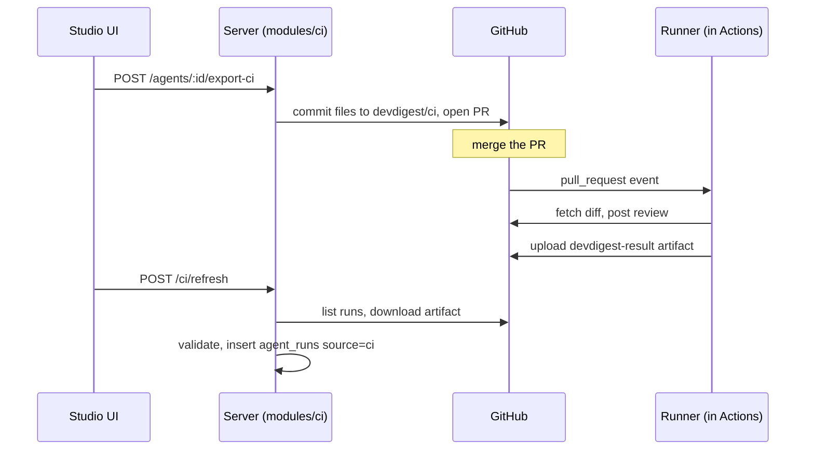

# Export to CI

Shipped by [spec 0022](../specs/0022-export-to-ci.md) (runner: PR #25, server and client: PR #28). A reviewer
agent tuned in the studio is exported into a target repo as a pull request; GitHub Actions then runs it on
every PR there, and the studio pulls the results back. Packages: `agent-runner/` (the CI runner),
`server/src/modules/ci/`, `client/` (agent CI tab and `/ci`). Decisions: [ADR 0001](adr/0001-pull-based-ci-ingest.md),
[ADR 0002](adr/0002-ship-runner-bundle-into-target-repo.md).

## Flow

## What the export writes

`POST /agents/:id/export-ci` (`server/src/modules/ci/routes.ts:29`). `action: "files"` only returns the file
set (no GitHub write, no row); `open_pr` publishes (`service.ts:145-147`). Files, built in `helpers.ts`
`buildCiFileSet`:

- `.github/workflows/devdigest-review.yml` (the only editable file),
- `.devdigest/agents/<slug>.yaml` manifest, `.devdigest/skills/<slug>.md` per enabled skill, empty
  `.devdigest/memory.jsonl`,
- `.devdigest/runner/**`: every file of `agent-runner/dist/` (`service.ts:58-76`).

Slugs are derived at export time and never stored; collisions get `-2`, `-3` (`helpers.ts` `slugFromName`).
The bundle is read before any GitHub call, so a missing build writes nothing (`service.ts:133-135`).
It fails with HTTP 500 `runner_bundle_missing` (`service.ts:48,66`): run `cd agent-runner && npm ci && npm run build`
on the studio host first. The bundle location is fixed by `constants.ts:32` (`DEFAULT_RUNNER_DIST_DIR`).

Publishing (`service.ts:208-255`): commit to branch `devdigest/ci` (`constants.ts:137`), open a PR titled
"Add DevDigest CI review" unless one is already open from that branch, then upsert the `ci_installations` row
only after every GitHub call succeeded. A GitHub failure marks an existing row `error` and returns GitHub's
message as an external-service error (`service.ts:238-242`).

### Re-export and "Update CI config"

- Open PR exists: new commit on top of the branch. No open PR (merged or closed): `devdigest/ci` is
  force-reset to the default branch head first (`service.ts:226`, `octokit.ts:277-284,321`), anything left on the
  stale branch is discarded.
- A re-export sets the row back to `pr_open` and bumps `workflow_version`
  (`repository/ci-installation.repo.ts:71-96`).
- `POST /agents/:id/ci/update` re-exports every `gha` installation of the agent from its stored triggers and
  `post_as`, one failure not stopping the rest (`service.ts:156-185`). It never passes `workflow_override`, so it
  regenerates the workflow and discards manual edits; the CI tab says so
  (`client/messages/en/ci.json:52`).
- A YAML edit made in the wizard wins: once edited, Configure no longer regenerates it, a notice says so
  (`ci.json:133`), and the text is sent as `workflow_override` and committed byte-for-byte
  (`ExportWizard.tsx:137-141`, `helpers.ts` `buildCiFileSet`). The server does not re-validate it; the PR review is
  the gate (`specs/0022-export-to-ci.md:105`).

### Studio-side requirements (not checked in code)

The studio's GitHub token must be able to write `.github/workflows/` (`workflow` scope for a classic token,
Workflows permission for fine-grained) and read Actions (for refresh); otherwise GitHub rejects the call and
that message is surfaced (`specs/0022-export-to-ci.md:477`). The target repo needs an `OPENROUTER_API_KEY`
Actions secret; the wizard only tells the user, DevDigest neither reads nor checks it (`ci.json:135-139`).

## The workflow

Generated by `modules/ci/workflow.ts`; its header (`workflow.ts:30-54`) lists the invariants:

- Trigger is `pull_request` only, types from `opened|synchronize|reopened` (default `opened, synchronize`)
  (`constants.ts:46-53`). Permissions are top-level `contents: read` + `pull-requests: write`
  (`constants.ts:69-72`).
- Fork gate: job `if: head.repo.full_name == github.repository` (`workflow.ts:103`, `constants.ts:79-80`).
- It checks out the PR **base** SHA, not the head (`workflow.ts:108-110`): the code run with the secrets is
  already on the base branch, so a PR cannot change it.
- A guard step skips (exit 0) while `.devdigest/runner/index.js` is not on base (`workflow.ts:112-116`), which
  is the case for the install PR itself. Reviews start with the first PR after that PR merges.
- `actions/checkout`, `setup-node`, `upload-artifact` are pinned to full commit SHAs (`constants.ts:103-107`).
- The upload step has `always()` so a run failed by the gate is still ingested (`workflow.ts:137`).

## The runner

`node .devdigest/runner/index.js` (`agent-runner/src/index.ts`). Env contract: `OPENROUTER_API_KEY`,
`GITHUB_TOKEN`, `GITHUB_REPOSITORY`, `PR_NUMBER`, `DEVDIGEST_COMMIT_SHA` (PR head SHA, 40 lowercase hex),
`DEVDIGEST_REPOSITORY_ID`, `DEVDIGEST_POST_AS` (`workflow.ts:126-132`, `context.ts:176-187`). An unknown
`post_as` falls back to `github_review` (`index.ts:30-33`).

- It reviews every manifest under `.devdigest/agents/` with the same reviewer-core engine as the studio
  (`run.ts:142-157`). Blockers and the gate come from the grounded findings and the manifest's `ci_fail_on`,
  not the model's verdict (`run.ts:162-163`); exit code is 1 if any gate triggered (`run.ts:206-209`).
- The artifact is written before posting, so a posting failure keeps the result (`run.ts:190-194`).
  `post_as` is `github_review`, `pr_comment` or `none` (`run.ts:196-203`).
- `.devdigest/` and `.github/workflows/` are stripped from the diff before review (`diff.ts:21`), otherwise the
  minified bundle makes GitHub reject the whole review with 422 on the export PR.
- Failures: invalid env or manifest exits 1 and writes nothing; after manifests load, any failure posts nothing
  and writes one `status: "error"` entry per manifest with secrets redacted. Zero manifests writes one
  `agent: null` entry (`run.ts:24-32,102-116,211-213`).
- The runner's own `isFork` is informational; the workflow condition is the fork gate (`context.ts:125-127`).

## Pull-based ingest (`POST /ci/refresh`)

There is no inbound endpoint (`routes.ts:18-19`). `CiService.refresh` (`service.ts:288-329`), per `gha`
installation, lists the last 30 (`constants.ts:131`) completed runs of `devdigest-review.yml` (`constants.ts:43`), then per run:

1. `isTrustedRun` (`helpers.ts:207`): event must be `pull_request` and the head repo equal the installed repo
   (case-insensitive); unknown head repo fails closed. Untrusted runs count as `skipped` **before any download**,
   because a fork can run its own workflow copy and upload a forged artifact.
2. Download artifact `devdigest-result`, read `devdigest-result.json` from the zip, capped at 1,000,000 bytes
   (`constants.ts:135`), validate as `CiResultArtifact[]`. Any failure skips the run (`service.ts:332-356`);
   a 404/410 is "absent", not an error (`octokit.ts:401-440`).
3. `classifyArtifactEntry` (`helpers.ts:224`): other agent's entry is ignored; `commit_sha` must equal the run's
   `head_sha`, `repository_id` the installation's, else the entry is `skipped`.
4. Accepted entries become `agent_runs` rows with `source='ci'` (`toAgentRunInsert`), inserted idempotently;
   a new row sets the installation `active` (`service.ts:372-378`). `status:"error"` entries become `failed`
   rows (`helpers.ts` `toAgentRunInsert`).

If listing an installation's runs throws, the refresh is `degraded` with the message and continues
(`service.ts:307-310`). `GET /ci/runs[?agent_id=]` lists at most 100 rows (`constants.ts:133`). The verdict shown
(`approve`/`request_changes`) derives from the stored `ci_gate_triggered`, never the agent's current
`ci_fail_on` (`helpers.ts:318-320`). The UI refreshes only on user action: the Refresh button on `/ci`
(`client/src/app/ci/_components/CiRunsView/CiRunsView.tsx:35`).

## Data model

- `ci_installations` (`server/src/db/schema/ci.ts:25-53`): `agent_id` (cascade), `repo`, `target_type`,
  `status` (`pr_open|active|error`), `workflow_version` (starts 1, +1 per re-export), `triggers` jsonb, `post_as`,
  `repository_id` bigint, `pr_url`, timestamps. Unique `(agent_id, repo)`. Enums are TypeScript-only, no DB CHECK.
- `agent_runs` CI columns (`schema/runs.ts:63-76`), all null for local runs: `ci_installation_id` (set null on
  delete), `repo`, `external_pr_number`, `commit_sha`, `actions_run_id` (bigint), `job_url`, `ci_gate_triggered`.
  Unique index `(ci_installation_id, actions_run_id)` makes ingest idempotent (`runs.ts:79-82`). Migration
  `0026_special_bill_hollister.sql`.
- `ci_runs` still exists but is unused scaffolding (`ci.ts:4-8`).
