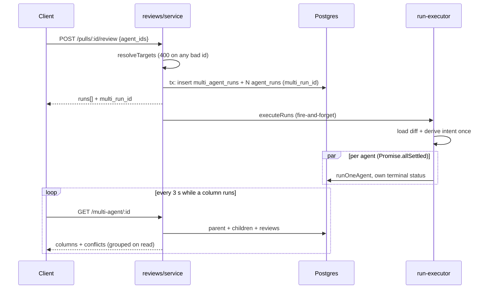

# Multi-Agent Review (server)

Shipped by [spec 0021](../../specs/0021-multi-agent-review.md). One request runs several
reviewer agents on the same PR in parallel; the server records them as one
**fan-out** and serves the columns plus a deterministic grouping of their findings.
The client side is in [`../../client/docs/multi-agent-review-ui.md`](../../client/docs/multi-agent-review-ui.md).

## Data model
- `multi_agent_runs` (`id`, `workspace_id`, `pr_id`, `ran_at`) is the parent (`src/db/schema/runs.ts:100`).
- `agent_runs.multi_run_id` is a nullable, indexed FK, `on delete set null` (`src/db/schema/runs.ts:47,61`).
  A single-agent run keeps it NULL and has no parent. Migration `0025` is purely additive.

## Flow

1. **Validation, in the service, as 400.** `resolveTargets` (`src/modules/reviews/service.ts:71`) rejects
   more than one of `agentId`/`all`/`agent_ids`, then empty / more than 10 / non-uuid / duplicate ids
   (`validateAgentIdsShape`, `src/modules/reviews/helpers.ts`), then unknown, foreign or disabled agents.
   It is not a Zod refinement on `RunRequest` because the API maps every `ZodError` to 422
   (`src/app.ts:177-186`) and the spec requires 400. The uuid check also keeps a malformed id from
   reaching an `inArray` on a uuid column and surfacing as a 500. Everything runs before any write.
   The caller's order is preserved (`service.ts:90`).
2. **One transaction.** With 2+ targets the parent row and all child rows are created together
   (`service.ts:187-192`), so a half-made fan-out cannot exist. One target takes the old path:
   no parent, `multi_run_id: null` (`service.ts:192`). `agentId` and `all` are unchanged, which is why
   a disabled agent can still be run alone through the API.
3. **Executor.** Diff and intent are loaded once and shared read-only; all agents then start together
   under `Promise.allSettled`, never `Promise.all`, so one throw or cancellation cannot stop the others
   (`src/modules/reviews/run-executor.ts:129-134`). A diff-load failure still fails every run through
   `failAll` (`run-executor.ts:84`). No new prompt path: each agent goes through the existing `runOneAgent`.
4. **Read routes** (`src/modules/reviews/routes.ts:73-80`). `GET /multi-agent/:id` is workspace-scoped,
   404 otherwise (`service.ts:256-261`). `GET /multi-agent/latest[?pr_id=]` returns `{ run: null }` when
   none exists; with `pr_id` an unknown or foreign PR is a 404, not an empty answer (`service.ts:269-276`).
   `latest` is a static segment so it outranks `:id`.
5. **Assembly.** `toMultiAgentRun` (`helpers.ts:194`) builds one column per child: a NULL status counts as
   `running`; total duration is the max of non-null durations (0 if none); total cost is a null-safe sum
   (null when every cost is null). Groups are computed **on every read**, never stored, so the rule below
   can change without a migration.

## Grouping rule
`groupFindings` (`src/modules/reviews/multi-agent-grouping.ts:67`) is pure (no DB, clock or `this`).
The decision to use geometry rather than text is recorded in
[`adr/0001-group-findings-by-line-overlap.md`](adr/0001-group-findings-by-line-overlap.md).

- **Linked** = same `file`, line ranges each widened by 2 lines (`TOLERANCE`) overlap, AND neither
  range is more than 3× the other's length (`MAX_LENGTH_RATIO`). Groups are the connected components
  (A~B and B~C is one group). The ratio stops a file-wide finding ("all routes lack auth", 9-64) from
  absorbing every narrow finding inside it; on PR #6 that had merged 9 unrelated findings.
- **Pruned pairwise union-find:** entries sorted by file, start, end, id; each is compared only with
  later entries that start before its widened end. 500 findings group in a few ms (AC-22).
- **Bounds against model-controlled numbers:** a null or inverted `end_line` is clamped to `start_line`
  (line 78), and the loop iterates findings, never line values, so `start_line = 2147483647` costs nothing.
- **Takes only for `done` columns** (line 70); a failed, cancelled or running column has no cell, so it
  can never read as "did not flag". Takes are keyed by `run_id`, not agent id, since a deleted agent's
  `agent_id` is null.
- **"Did not flag":** a `done` column with no member in the group gets `verdict: 'ignored'`, `note: ''`,
  `finding_ids: []` (line 119).
- **Attribution:** every input finding id appears once, in `finding_ids` of the take of the run that
  produced it.
- **Selection:** a flagged take's verdict is its highest severity and its note that finding's title; the
  group title is the top-severity finding's. Ties break on lowest start, then id (`topOf`, line 58).
- **`divergent`** is true when the agents that flagged the group disagree on severity; `ignored` takes
  are left out. With specialised agents nearly every group has a silent agent, so counting "did not
  flag" made every group a conflict and the "Show only conflicts" filter a no-op.
- **Determinism:** takes are ordered by (agent name, run id) inside the function (line 70-72), and every
  sort ends at the id, so output depends only on the set of inputs, not on column order.

## Estimates on `GET /agents`
`AgentsRepository.estimatesForWorkspace` (`src/modules/agents/repository.ts`) averages `duration_ms` and
`cost_usd` per agent over **`done` runs only**, in one grouped query; failed, cancelled and running runs
never count. `avg()` of a numeric arrives as a string and is converted. An agent with no done run is
absent from the map, and the service returns `est_duration_ms` / `est_cost_usd` as `null`
(`src/modules/agents/service.ts`; contract `src/vendor/shared/contracts/knowledge.ts:427-428`).
The mean is per agent over its whole history, not per PR. The fan-out summary (max time, sum cost) is
computed by the client.

## Why extend `POST /review` instead of adding a route
The trigger already creates rows up front, returns run ids and fires the executor; a second route would
duplicate rate limiting, PR/repo lookup and validation. `agent_ids` is a third, mutually exclusive
selector next to `agentId` and `all`, and `multi_run_id` is added to the response (null for 0-1 runs).
